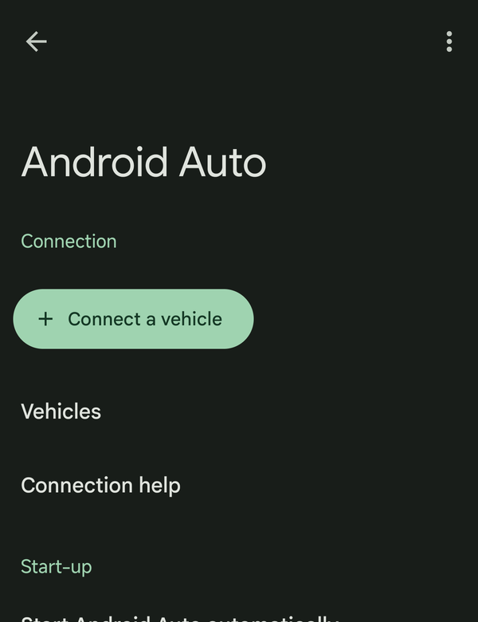
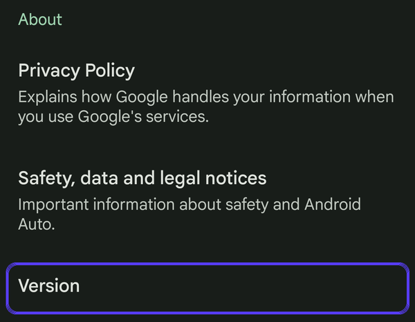
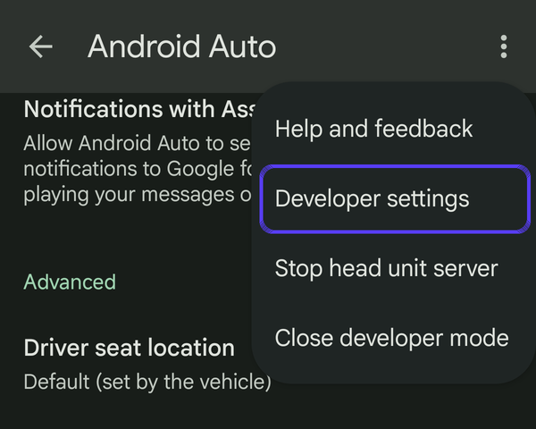
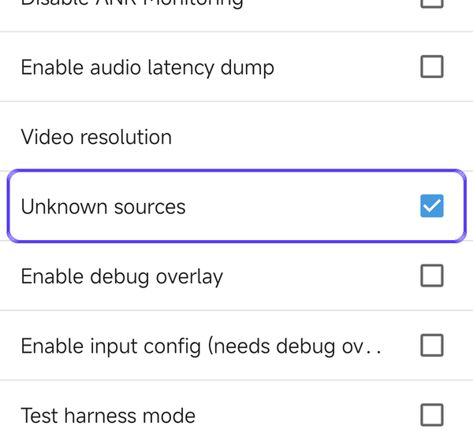

# Use boxlore with Android Auto

boxlore works with Android Auto: browse your shows and play episodes on your car's screen.

**Installed boxlore from Google Play?** It already shows up in your car. You don't need this page.

**Installed it from GitHub or Obtainium?** Android Auto only shows apps that came from Google Play, unless you turn on one setting called **Unknown sources**. It takes about a minute, and you only do it once.

## 1. Open Android Auto's settings

Android Auto is built into your phone, so it usually has no app icon. Its settings are inside your phone's **Settings** app:

- **Any phone:** open **Settings** and search for **Android Auto**.
- **Pixel:** Settings → Connected devices → Connection preferences → Android Auto.
- **Samsung:** Settings → Connected devices → Android Auto.

If your phone does have an Android Auto app icon, opening it takes you to the same screen.

## 2. Turn on developer settings

Scroll to the bottom and tap **Version** about 10 times. When Android Auto asks whether to allow development settings, tap **OK**.

## 3. Open Developer settings

Tap the **⋮** menu at the top right, then **Developer settings**.

## 4. Turn on Unknown sources

Scroll down and tick **Unknown sources**. Leave everything else on this page as it is.

## 5. Reconnect your car

Unplug your phone and plug it back in, or reconnect wireless Android Auto. boxlore now appears with your other apps on the car screen. If it doesn't, restart your phone and connect again.

## If boxlore disappears again

Android Auto updates sometimes switch developer settings off. Go through steps 1 to 5 again.

## Why this is needed

Android Auto runs apps from a trusted source such as Google Play. **Unknown sources** is the setting Google provides for apps installed another way, such as from GitHub. Google describes it in its guide for app developers, [Test Android apps for cars](https://developer.android.com/training/cars/testing).
