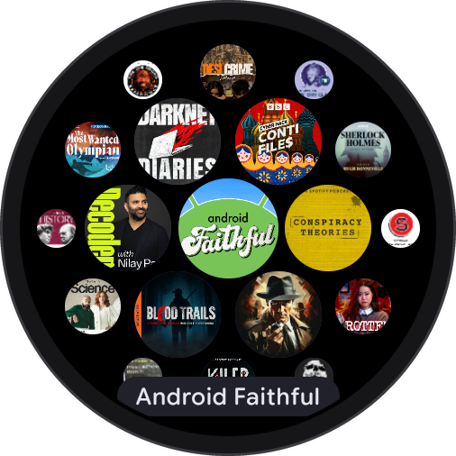
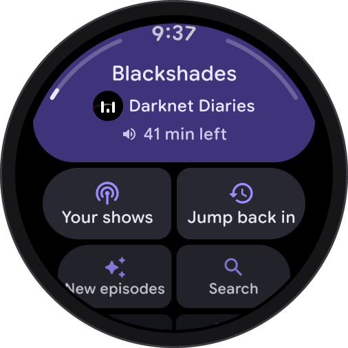
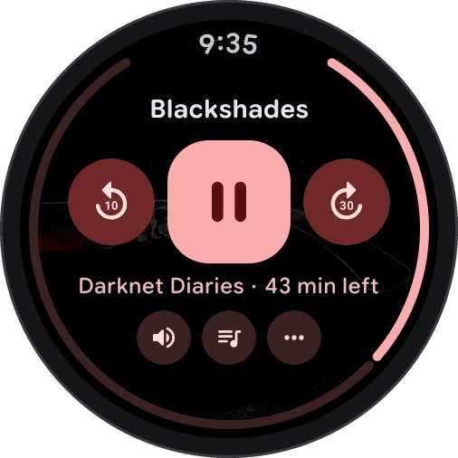
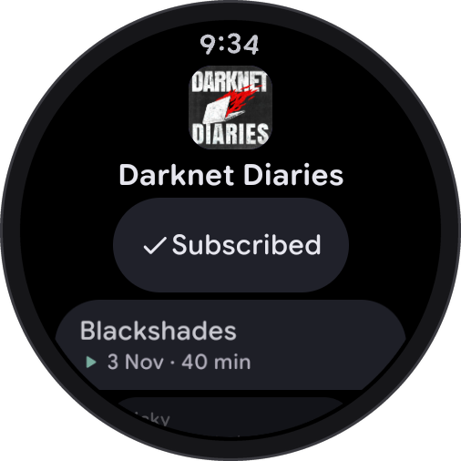
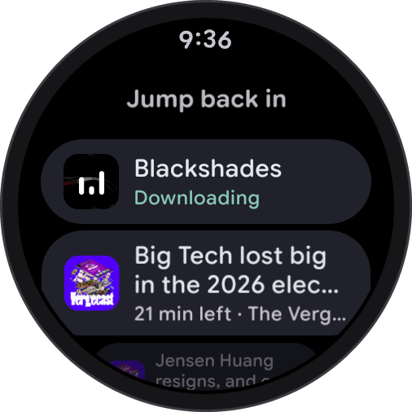
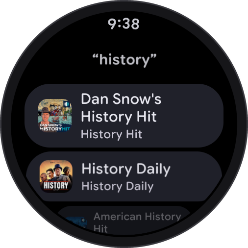

# boxlore on Wear OS

boxlore is on Wear OS watches. The watch app is out now on [GitHub Releases](https://github.com/boxcreate/boxlore/releases/latest), starting with boxlore 0.0.32, and it's coming to Google Play very soon. [How to install it](#how-to-install-it) has the steps.

<table>
  <tr>
    <td align="center"></td>
    <td align="center"></td>
    <td align="center"></td>
  </tr>
  <tr>
    <td align="center"><b>Your shows</b> Every show you subscribe to, in a honeycomb you can scroll.</td>
    <td align="center"><b>Home</b> What's playing sits at the top, shaped to the watch.</td>
    <td align="center"><b>Player</b> Coloured from the artwork, with a ring that shows how far in you are.</td>
  </tr>
  <tr>
    <td align="center"></td>
    <td align="center"></td>
    <td align="center"></td>
  </tr>
  <tr>
    <td align="center"><b>Show page</b> Subscribe and browse episodes on your wrist.</td>
    <td align="center"><b>Jump back in</b> Episodes you started, with the time left.</td>
    <td align="center"><b>Search</b> Type or speak to find any show.</td>
  </tr>
</table>

## What it does

- **Plays without your phone.** Stream episodes or download them to the watch, then leave your phone at home.
- **Keeps your place.** With boxlore on your phone, your shows and listening progress carry over to the watch and back.
- **Uses your account.** boxlore on the watch works with your boxlore account. Your phone signs the watch in with one tap, and your shows and progress sync even when the phone is away.
- **Controls your phone's player.** When an episode is playing on your phone, pause it or skip from the watch, or move it to the watch and carry on from the same place.
- **Send to watch.** Download an episode to the watch from its page on your phone.
- **Tile and watch face.** Jump back into your last episode from a tile or a watch-face shortcut.
- **Search and Subscribe.** Find a show by typing or speaking, and subscribe from the watch.
- **Player extras.** Playback speed, a sleep timer and Up next.
- **Made for round screens.** Home's top card follows the curve of the watch, on large and small watches.

## Where can I get it?

- **GitHub Releases: out now.** Every boxlore release from 0.0.32 on includes the watch app next to the phone app.
- **Google Play: very soon.** The watch app is on its way to Google Play. If your phone app is from Google Play, you can wait for it there, or install the watch app from GitHub now and use it on its own (see [why](#get-both-apps-from-the-same-place)).

## How to install it

The watch needs Wear OS 4 or later. boxlore on your phone is optional: the watch app also works on its own.

### Get both apps from the same place

The watch app and the phone app link only when both come from the same place:

| boxlore on your phone is from | Install the watch app from |
| :--- | :--- |
| Google Play | Google Play (very soon) |
| GitHub Releases or Obtainium | GitHub Releases |

If the two don't match, each app still works on its own, but they can't share shows and progress, control each other's player, or sign the watch in.

### From GitHub Releases

Wear OS has no file manager to install from, so this route uses a computer with `adb`, Android's developer tool.

1. From the [latest release](https://github.com/boxcreate/boxlore/releases/latest), download the file named `boxlore-wear-` followed by the version, ending in `.apk`. It is the watch app that matches that release's phone app.
2. On the watch, go to **Settings > System > About > Versions** and tap **Build number** seven times to turn on developer options.
3. In **Settings > Developer options**, turn on **ADB debugging** and **Wireless debugging**, then pair your computer under **Wireless debugging > Pair new device**.
4. On the computer, run `adb install` followed by the path to the downloaded file.
5. Open boxlore on the watch. You can turn the debugging options off again.

Menu names differ slightly between watch makers.

### From Google Play

The watch app isn't on Google Play yet. Once it is:

1. On your watch, open the Play Store and search for **boxlore**. Or, on your phone, open [boxlore on Google Play](https://play.google.com/store/apps/details?id=cx.aswin.boxlore) and choose your watch from the install menu.
2. Install it, then open boxlore on the watch.

### Set it up

- **Link with your phone.** Open boxlore on both. With matching apps and the phone in reach, your shows and progress appear on the watch on their own.
- **Sign in.** boxlore on the watch needs your account. Sign in to boxlore on your phone, keep the phone in reach, and open boxlore on the watch: it signs in through your phone. (On earlier versions, open **Settings > Account > Sign in with phone** on the watch.)
- **Add the tile.** Swipe to the end of your tiles, add one, and pick boxlore.
- **Add the watch-face shortcut.** Customise your watch face and pick boxlore for one of its slots.

Have an idea or a request for the watch app? [Open an issue](https://github.com/boxcreate/boxlore/issues).

Screenshots are from a development build running on a virtual watch.
