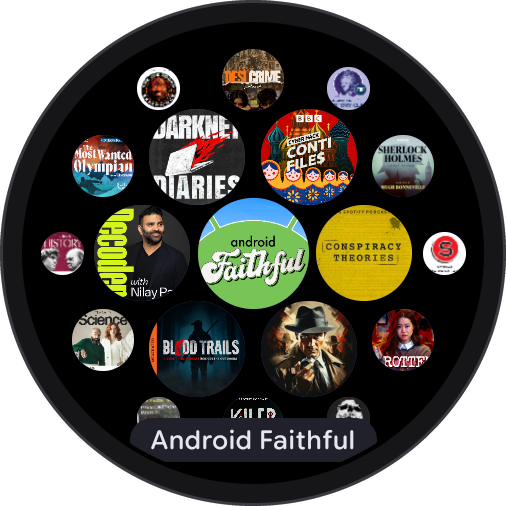
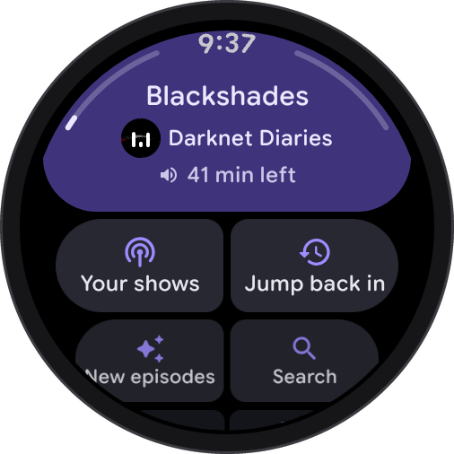
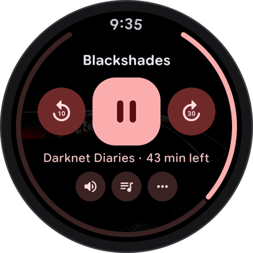
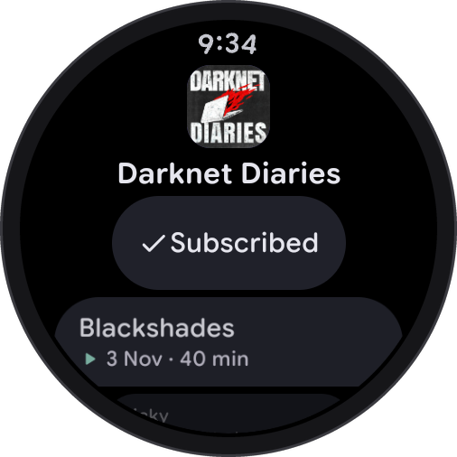
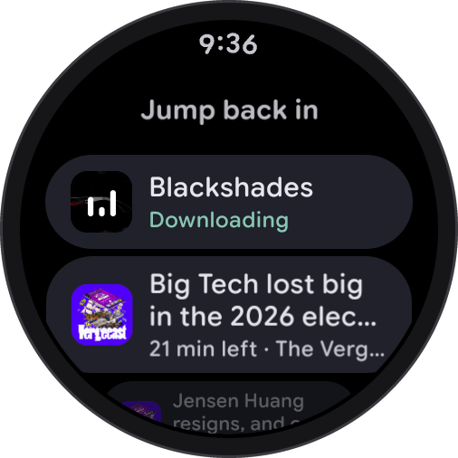
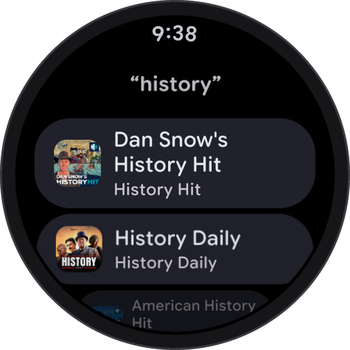

# boxlore on Wear OS: a first look

boxlore is coming to Wear OS watches. This is an early look at the watch app while it is still being built. You can't install it yet, and details may change before release.

<table>
  <tr>
    <td align="center"></td>
    <td align="center"></td>
    <td align="center"></td>
  </tr>
  <tr>
    <td align="center"><b>Your shows</b> Every show you subscribe to, in a honeycomb you can scroll.</td>
    <td align="center"><b>Home</b> What's playing sits at the top, shaped to the watch.</td>
    <td align="center"><b>Player</b> Coloured from the artwork, with a ring that shows how far in you are.</td>
  </tr>
  <tr>
    <td align="center"></td>
    <td align="center"></td>
    <td align="center"></td>
  </tr>
  <tr>
    <td align="center"><b>Show page</b> Subscribe and browse episodes on your wrist.</td>
    <td align="center"><b>Jump back in</b> Episodes you started, with the time left.</td>
    <td align="center"><b>Search</b> Type or speak to find any show.</td>
  </tr>
</table>

## What it does

- **Plays without your phone.** Stream episodes or download them to the watch, then leave your phone at home.
- **Keeps your place.** With boxlore on your phone, your shows and listening progress carry over to the watch and back.
- **Controls your phone's player.** When an episode is playing on your phone, pause it or skip from the watch.
- **Search and Subscribe.** Find a show by typing or speaking, and subscribe from the watch.
- **Player extras.** Playback speed, a sleep timer and Up next.
- **Made for round screens.** Home's top card follows the curve of the watch, on large and small watches.

## When can I get it?

There is no date yet. The watch app is still being built and tested.

Have an idea or a request for the watch app? [Open an issue](https://github.com/boxcreate/boxlore/issues).

Screenshots are from a development build running on a virtual watch.
